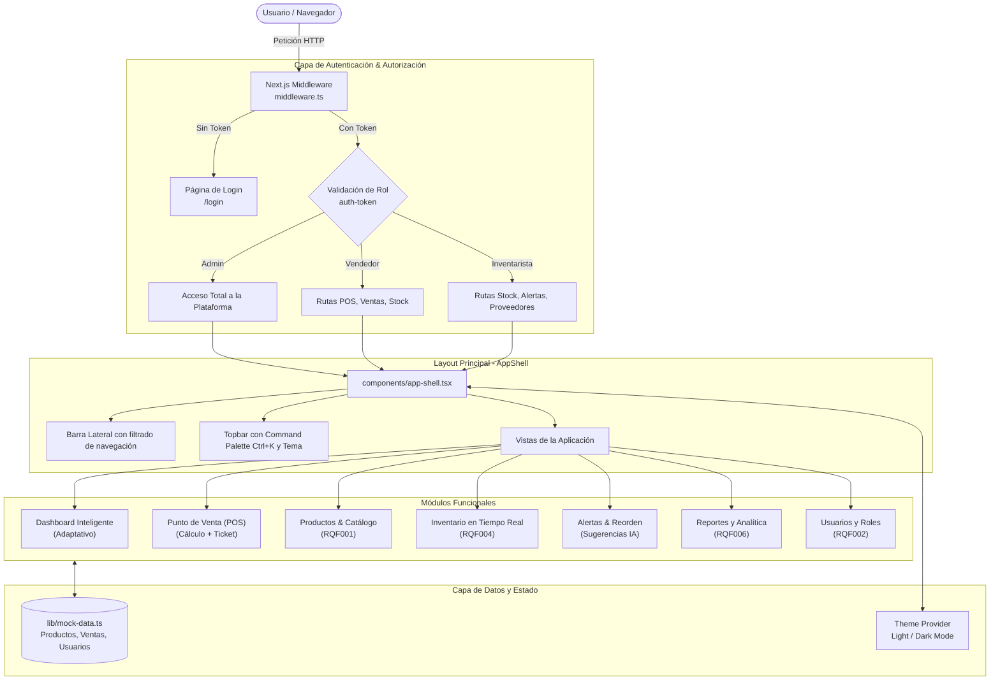

# 📦 Stockly — Sistema Integral de Inventario y Punto de Venta (SIDT)

> Plataforma web inteligente para la administración en tiempo real de inventarios, facturación en punto de venta (POS), analítica comercial, control de proveedores y gestión de roles con control de acceso basado en roles (RBAC).

[](https://nextjs.org/)
[](https://react.dev/)
[](https://tailwindcss.com/)
[](https://www.typescriptlang.org/)
[](LICENSE)

---

## 📑 Tabla de Contenidos

- [Visión General](#-visión-general)
- [Características Principales](#-características-principales)
- [Matriz de Roles y Permisos (RBAC)](#-matriz-de-roles-y-permisos-rbac)
- [Trazabilidad de Requisitos de Software (RQF / RQNF)](#-trazabilidad-de-requisitos-de-software-rqf--rqnf)
- [Arquitectura del Sistema](#-arquitectura-del-sistema)
- [Estructura del Proyecto](#-estructura-del-proyecto)
- [Stack Tecnológico](#-stack-tecnológico)
- [Instalación y Puesta en Marcha](#-instalación-y-puesta-en-marcha)
- [Credenciales de Demostración](#-credenciales-de-demostración)
- [Rutas y Módulos de la Aplicación](#-rutas-y-módulos-de-la-aplicación)
- [Próximos Pasos y Hoja de Ruta](#-próximos-pasos-y-hoja-de-ruta)
- [Licencia y Créditos](#-licencia-y-créditos)

---

## 🌟 Visión General

**Stockly (SIDT)** es una solución moderna desarrollada para comercios y negocios minoristas que buscan simplificar su operación diaria. Combina la rapidez de un terminal de Punto de Venta (POS) con la precisión de un sistema de control de existencias, cálculo de márgenes, alertas automáticas de desabastecimiento y métricas clave de salud del negocio (*Business Health Score*).

El sistema está configurado y adaptado para el contexto comercial colombiano (moneda en **COP**, cálculo de impuestos, formato local de fechas y datos de proveedores típicos), cumpliendo con los estándares de diseño y desarrollo de software recomendados por el **SENA** (Servicio Nacional de Aprendizaje).

---

## 🚀 Características Principales

### 1. 📊 Dashboards Adaptativos por Rol
- **Panel Administrativo:** Muestra el *Business Health Score* (86/100), KPIs financieros con gráficas *sparkline*, tendencias de ventas semanales vs. metas, ventas por hora en tiempo real, distribución de ventas por categoría y recomendaciones automáticas de reorden.
- **Panel del Vendedor:** Enfocado en la productividad operativa, mostrando total vendido en el turno, número de transacciones realizadas, accesos directos al POS y alertas de existencias en modo lectura.
- **Panel del Inventarista:** Enfocado en la reposición física, estado de productos críticos y sugerencias de abastecimiento prioritario.

### 2. 🛒 Terminal de Punto de Venta (POS)
- Búsqueda reactiva por nombre o lector de **código de barras**.
- Filtrado ágil por categorías (Bebidas, Snacks, Lácteos, Aseo, Panadería, Granos).
- Carrito interactivo con control de cantidades, cálculo dinámico de subtotal, impuestos aplicables (8%) y total.
- Métodos de pago integrados: **Efectivo**, **Tarjeta** y **Transferencia**.
- Modal de confirmación con detalle de transacción y ticket digital.

### 3. 📦 Catálogo de Productos y Existencias Físicas
- Visualización dual: **cuadrícula de tarjetas visuales** o **tabla de datos detallada**.
- Control estricto de **SKU**, código de barras, categoría, proveedor asignado, precio de venta, costo unitario y stock mínimo.
- Registro modal de nuevos productos con validación de datos.
- Barras de nivel de stock con código de colores según criticidad (*Disponible*, *Stock bajo*, *Agotado*).

### 4. 🚨 Monitor y Alertas de Stock
- Detección automática de productos agotados o por debajo del umbral mínimo configurado.
- Algoritmo de **reorden sugerido** que calcula automáticamente el lote óptimo a solicitar y el costo de inversión estimado.
- Acción rápida de marcado como *Reabastecido*.

### 5. 📈 Reportes Analíticos y Financieros
- Análisis de ingresos, transacciones y márgenes porcentuales por periodo (**Hoy**, **Semana**, **Mes**, **Trimestre**, **Año**).
- Gráficos nativos en SVG (*Area Chart*, *Bar Chart* y *Donut Chart*) sin dependencias externas pesadas.
- Botones listos para exportación a formato **Excel** y **PDF**.

### 6. 👥 Gestión de Usuarios y Seguridad
- Creación y administración de cuentas con asignación de roles.
- Indicador de estado (*Activo* / *Inactivo*), registro de última actividad y ventas acumuladas por usuario.
- Interceptación y validación de sesiones mediante **Next.js Middleware**.

### 7. ⚡ Experiencia de Usuario de Vanguardia
- **Command Palette (`Ctrl + K` / `Cmd + K`):** Búsqueda global y atajos de teclado para navegación instantánea.
- **Modo Oscuro / Claro:** Selector de tema completo con persistencia en `localStorage` y detección de preferencias del sistema.
- Diseño 100% responsivo para pantallas móviles, tablets y monitores de escritorio.

---

## 🛡️ Matriz de Roles y Permisos (RBAC)

La plataforma cuenta con un esquema de autorización validado en el servidor a través de `middleware.ts` y reflejado dinámicamente en el menú lateral:

| Módulo / Ruta | Administrador | Vendedor | Inventarista | Propósito |
| :--- | :---: | :---: | :---: | :--- |
| **`/` (Dashboard)** | ✅ Completo | ✅ Modo Vendedor | ✅ Modo Inventarista | Resumen ejecutivo y operativo |
| **`/pos` (Punto de Venta)** | ✅ | ✅ | ❌ | Terminal de facturación rápida |
| **`/ventas` (Ventas)** | ✅ | ✅ | ❌ | Historial de transacciones y tickets |
| **`/productos` (Catálogo)** | ✅ | ✅ | ✅ | Catálogo de artículos y registro |
| **`/inventario` (Stock)** | ✅ | ✅ | ✅ | Consulta de existencias físicas |
| **`/alertas` (Alertas)** | ✅ | ✅ (Lectura) | ✅ (Gestión) | Notificaciones de stock crítico |
| **`/reportes` (Analítica)** | ✅ | ❌ | ❌ | Reportes comerciales y financieros |
| **`/proveedores` (Proveedores)**| ✅ | ❌ | ✅ | Directorio de distribuidores |
| **`/usuarios` (Usuarios)** | ✅ | ❌ | ❌ | Administración de accesos y credenciales |
| **`/configuracion` (Ajustes)** | ✅ | ❌ | ❌ | Datos del negocio y preferencias |

---

## 📋 Trazabilidad de Requisitos de Software (RQF / RQNF)

El sistema da cumplimiento directo a los requisitos del pliego de condiciones de software:

| Código | Tipo | Descripción | Implementación en el Proyecto |
| :--- | :---: | :--- | :--- |
| **RQF001** | Funcional | Registro y catalogación de productos | Implementado en `app/(app)/productos/page.tsx` con formulario modal, SKU, código de barras y niveles mínimos. |
| **RQF002 / CU_02** | Funcional | Administración de usuarios y roles de acceso | Implementado en `app/(app)/usuarios/page.tsx` con matriz de permisos y roles (Admin, Vendedor, Inventarista). |
| **RQF003** | Funcional | Actualización automática de existencias tras una venta | Implementado en `app/(app)/pos/page.tsx` al registrar y cerrar transacciones en el POS. |
| **RQF004** | Funcional | Consulta en tiempo real de disponibilidad física | Implementado en `app/(app)/inventario/page.tsx` con filtros por estado, barras de nivel y valorización de inventario. |
| **RQF006** | Funcional | Generación y análisis de reportes comerciales y económicos | Implementado en `app/(app)/reportes/page.tsx` con métricas de margen, volumen de ventas y gráficos de ingresos. |
| **RQNF003** | No Funcional | Seguridad, autenticación y confiabilidad de datos | Implementado en `middleware.ts`, gestión de cookies de sesión `auth-token` y protección de rutas privadas. |

---

## 🏛️ Arquitectura del Sistema



---

## 📂 Estructura del Proyecto

```text
integral-inventory-system/
├── app/
│   ├── (app)/                       # Grupo de rutas protegidas bajo AppShell
│   │   ├── layout.tsx               # Carga de cookie de rol y envoltura de AppShell
│   │   ├── page.tsx                 # Dashboard principal (dinámico según rol)
│   │   ├── alertas/page.tsx         # Gestión de alertas de stock crítico y reorden
│   │   ├── configuracion/page.tsx   # Configuración de empresa, apariencia y notificaciones
│   │   ├── inventario/page.tsx      # Existencias físicas en tiempo real (RQF004)
│   │   ├── pos/page.tsx             # Terminal de Punto de Venta y cobro (RQF003)
│   │   ├── productos/page.tsx       # Catálogo de productos y altas (RQF001)
│   │   ├── proveedores/page.tsx     # Directorio de proveedores
│   │   ├── reportes/page.tsx        # Métricas comerciales y balances (RQF006)
│   │   ├── usuarios/page.tsx        # Gestión de cuentas y perfiles (RQF002)
│   │   └── ventas/page.tsx          # Historial de ventas y transacciones detalladas
│   ├── login/
│   │   └── page.tsx                 # Pantalla de inicio de sesión con selector de demo
│   ├── globals.css                  # Variables de tema CSS y tokens de Tailwind v4
│   └── layout.tsx                   # Layout raíz (fuentes, ThemeProvider, analítica)
├── components/
│   ├── ui/                          # Primitivas de UI (botones, elementos base)
│   ├── app-shell.tsx                # Envoltorio del diseño con barra lateral y topbar
│   ├── app-sidebar.tsx              # Menú lateral con navegación adaptada por rol
│   ├── charts.tsx                   # Componentes nativos de gráficas SVG (Área, Barras, Donut)
│   ├── command-palette.tsx          # Paleta de comandos accesible vía Ctrl+K / Cmd+K
│   ├── dashboard-admin.tsx          # Dashboard completo con analítica avanzada para Admin
│   ├── kit.tsx                      # Componentes reutilizables (Card, Modal, Badge, Field, etc.)
│   ├── theme-provider.tsx           # Contexto React para alternancia de temas Claro / Oscuro
│   └── topbar.tsx                   # Cabecera superior con búsqueda y perfil de usuario
├── lib/
│   ├── mock-data.ts                 # Modelos TypeScript, formateadores COP y datos iniciales
│   └── utils.ts                     # Utilidad 'cn' (clsx + tailwind-merge)
├── middleware.ts                    # Middleware de control de acceso y RBAC
├── components.json                  # Configuración de Shadcn UI
├── next.config.mjs                  # Configuración de Next.js
├── package.json                     # Metadatos del proyecto y dependencias
├── postcss.config.mjs               # Configuración de procesamiento PostCSS
└── tsconfig.json                    # Configuración estricta de TypeScript
```

---

## 🛠️ Stack Tecnológico

| Capa | Herramienta | Versión | Descripción |
| :--- | :--- | :--- | :--- |
| **Framework** | [Next.js](https://nextjs.org/) | `16.2.6` | App Router, Server Components y Middleware perimetral |
| **Librería UI** | [React](https://react.dev/) | `19.2.4` | Renderizado declarativo con Server and Client Components |
| **Estilos** | [Tailwind CSS](https://tailwindcss.com/) | `v4.2.0` | Motor de estilos de última generación con variables CSS directas |
| **Animaciones** | `tw-animate-css` | `1.4.0` | Transiciones fluidas y animaciones de entrada (`animate-fade-up`) |
| **Iconografía** | [Lucide React](https://lucide.dev/) | `1.16.0` | Conjunto consistente de más de 1000 iconos vectoriales |
| **Primitivas UI** | `@base-ui/react` & `shadcn` | `1.5.0` | Primitivas accesibles y headless |
| **Lenguaje** | [TypeScript](https://www.typescriptlang.org/) | `5.7.3` | Tipado estático robusto en todas las capas del sistema |
| **Gráficos** | SVG Nativos | Integrado | Gráficas responsivas ligeras sin librerías externas pesadas |

---

## ⚡ Instalación y Puesta en Marcha

### Prerrequisitos
- **Node.js**: Versión 18.18.0 o superior (se recomienda Node 20 LTS o superior).
- **Gestor de paquetes**: `npm`, `pnpm` o `yarn`.

### Pasos de Instalación

1. **Clonar o ubicarse en el directorio del proyecto:**
   ```bash
   cd integral-inventory-system
   ```

2. **Instalar las dependencias:**
   Si utilizas `pnpm`:
   ```bash
   pnpm install
   ```
   O con `npm`:
   ```bash
   npm install
   ```

3. **Iniciar el servidor de desarrollo:**
   ```bash
   npm run dev
   # o
   pnpm dev
   ```

4. **Acceder a la aplicación:**
   Abre tu navegador en [http://localhost:3000](http://localhost:3000).

5. **Compilar para producción:**
   ```bash
   npm run build
   npm run start
   ```

---

## 🔑 Credenciales de Demostración

La página de inicio de sesión (`/login`) cuenta con botones rápidos para probar cualquiera de los tres roles predefinidos sin necesidad de escribir contraseñas:

| Rol | Correo Electrónico sugerido | Contraseña | Vistas Accesibles |
| :--- | :--- | :--- | :--- |
| **Administrador** | `admin@sena.edu.co` | *Cualquiera* (`senasoft`) | Acceso total a todos los módulos y configuraciones. |
| **Vendedor** | `vendedor@sena.edu.co` | *Cualquiera* (`senasoft`) | POS, Ventas, Inventario, Catálogo y Alertas (lectura). |
| **Inventarista** | `inventarista@sena.edu.co` | *Cualquiera* (`senasoft`) | Inventario, Alertas, Productos y Proveedores. |

> 💡 **Nota:** La autenticación almacena una cookie segura de sesión `auth-token=<rol>` que expira automáticamente en 24 horas. Para cerrar sesión, basta con pulsar el botón **"Cerrar sesión"** ubicado al final de la barra lateral.

---

## 📌 Rutas y Módulos de la Aplicación

| Ruta | Nombre del Módulo | Funcionalidades Clave |
| :--- | :--- | :--- |
| `/login` | **Autenticación** | Inicio de sesión, validación de credenciales y botones de acceso rápido por rol. |
| `/` | **Dashboard** | Tarjetas de KPI, gráficos de tendencia, ventas por hora y salud financiera del negocio. |
| `/pos` | **Punto de Venta** | Facturación directa, escaneo de códigos de barra, selección de medios de pago y recibos. |
| `/productos` | **Productos** | Catálogo general, vista en tarjetas o lista, registro modal con precio, costo y SKU. |
| `/inventario` | **Inventario Físico** | Disponibilidad en tiempo real, valor total del stock y barra porcentual de reposición. |
| `/ventas` | **Historial de Ventas** | Acordeón con desglose de ítems vendidos, cajero responsable y método de pago. |
| `/alertas` | **Alertas de Stock** | Listado de productos agotados o críticos con cantidad de compra sugerida. |
| `/proveedores`| **Proveedores** | Fichas de proveedores con teléfono de contacto y cantidad de productos provistos. |
| `/reportes` | **Reportes** | Balances financieros por periodo, márgenes estimados y exportación de datos. |
| `/usuarios` | **Usuarios y Roles** | Alta de empleados, asignación de permisos y estado de actividad del personal. |
| `/configuracion`| **Configuración** | Datos fiscales (NIT, dirección), selector de tema (Claro/Oscuro) y notificaciones. |

---

## 🚀 Próximos Pasos y Hoja de Ruta

- [ ] **Persistencia en Base de Datos Real:** Conexión con PostgreSQL o Supabase utilizando un ORM (Prisma / Drizzle) en reemplazo del mock en memoria.
- [ ] **Facturación Electrónica:** Integración con la API de la DIAN o proveedores tecnológicos locales de facturación electrónica.
- [ ] **Lector Físico de Código de Barras / QR:** Soporte para lectura mediante cámara web usando la API `BarcodeDetector` o librerías WebRTC.
- [ ] **Módulo de Compras y Órdenes de Pedido:** Generación de órdenes de compra automáticas en formato PDF enviadas por correo a proveedores.
- [ ] **Impresión Térmica:** Soporte para tickets en impresoras POS térmicas de 58mm y 80mm vía ESC/POS o `window.print`.

---

## 📄 Licencia y Créditos

Este proyecto fue concebido y desarrollado como parte de las iniciativas de innovación tecnológica y formativa del **SENA**. Distribuido bajo la licencia [MIT](LICENSE).

